# Order Notifier

Personal motivation app for Android (Pixel) and iPhone. Posts random, local-only "new order"
notifications to *your own phone*. Nothing is sent anywhere; it only works on the
device it's installed on.

The Android app is in `app/`. The iPhone app is in `ios/`, see [iPhone](#iphone) below.

| Home | Customize | Timing | Alerts |
| --- | --- | --- | --- |
| 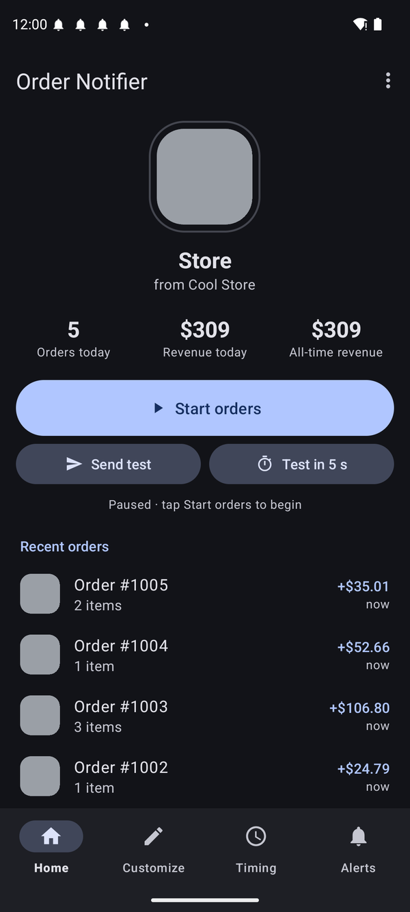 | 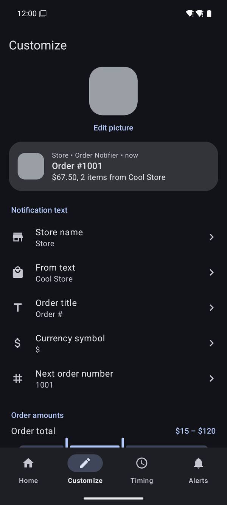 | 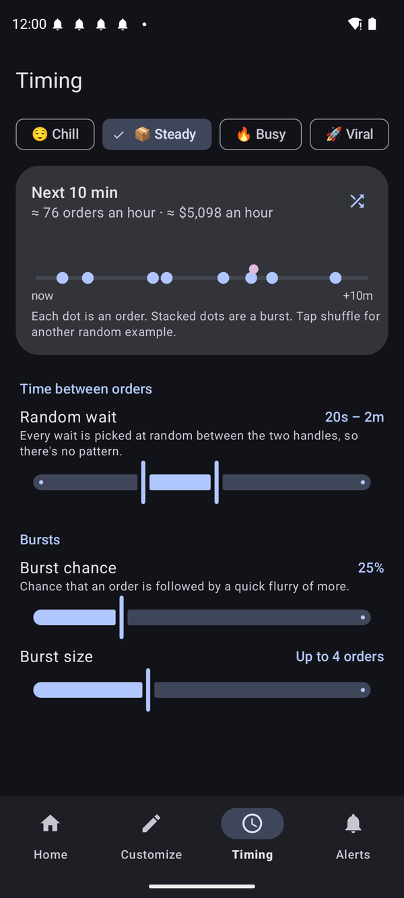 | 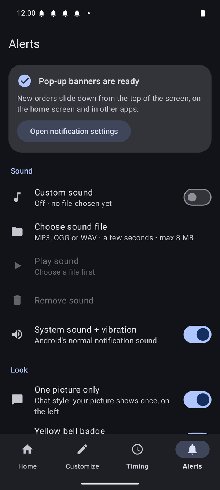 |

| Editing the "from" text | Pop-up banner | Notification shade |
| --- | --- | --- |
| 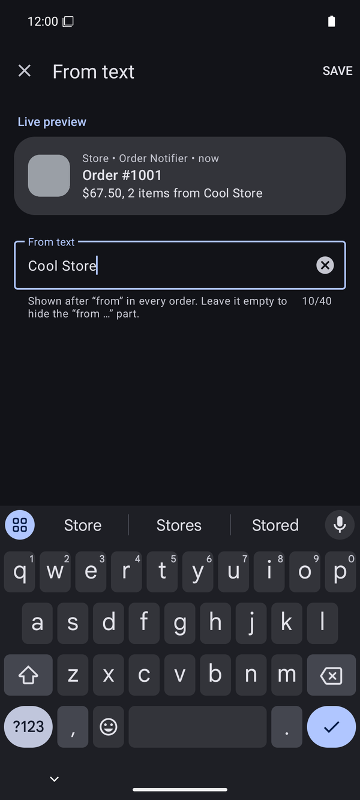 | 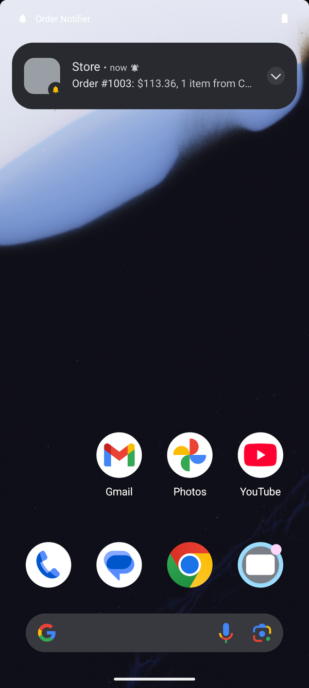 | 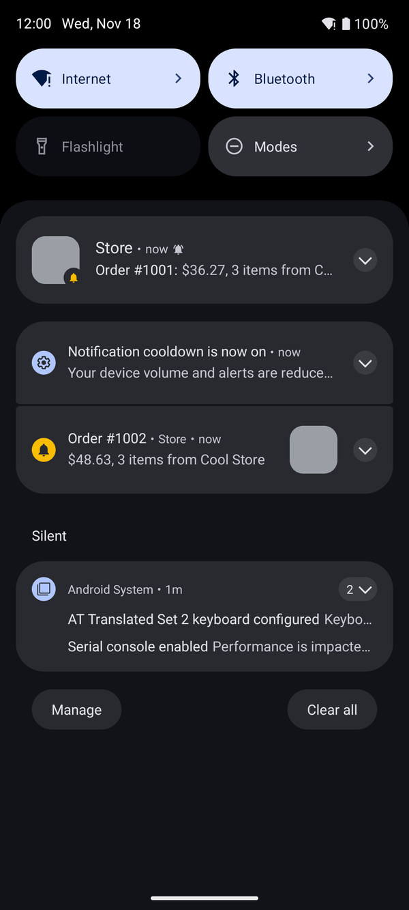 |

## What's in it

- **Home**: your store's picture with a "live" ring while orders are on, today's orders and
  revenue, a big Start/Stop button, test buttons and a feed of recent orders.
- **Customize**: picture, store name, the "from …" text, order title, currency and next order
  number. Each opens its own editor with a live preview. Order totals and items per order.
- **Timing**: one-tap presets (Chill, Steady, Busy, Viral), random wait range, burst chance and
  size, plus an example timeline and an orders-per-hour estimate.
- **Alerts**: checks that pop-up banners can show, custom notification sound (silenced by Do Not
  Disturb), system sound, chat style (picture shown once) and keep-awake.
- Blank slate defaults: name "Store", "from Online Store", grey picture, no branding.

## Install on Android

GitHub → Actions → latest **Build APK** run → download `app-debug` → unzip → install the APK
on your phone (allow "install unknown apps"). Or open the project in Android Studio and Run.

The default texts live in `Settings.kt` (`DEFAULT_STORE_NAME`, `DEFAULT_FROM_TEXT`, `DEFAULT_TITLE_PREFIX`).

## Android screenshots

`docs/screenshots` is refreshed automatically by the **UI screenshots** workflow, which runs the app
on an Android 14 emulator (`scripts/ui-screenshots.sh`, `scripts/ui-flow.sh`).

## iPhone

`ios/` is the same app rebuilt for iPhone in SwiftUI, in Apple's style: Liquid Glass cards, buttons
and tab bar on iOS 26 (frosted glass on iOS 17 and 18), a tab bar that shrinks as you scroll with a
live "mini player" above it, SF Symbols, haptics and dark mode. Every Android feature is there, plus
**Siri and Shortcuts**: Go Live, Pause Orders and Send a Test Order work from Siri, Spotlight, the
Action Button and Shortcuts automations (for example: go live every weekday at 9:00).

| Home | Customize | Timing | Alerts |
| --- | --- | --- | --- |
| 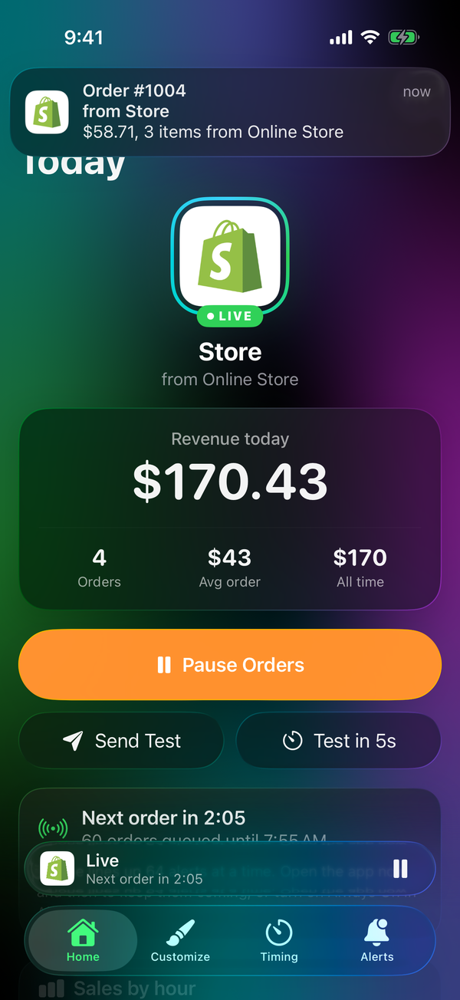 | 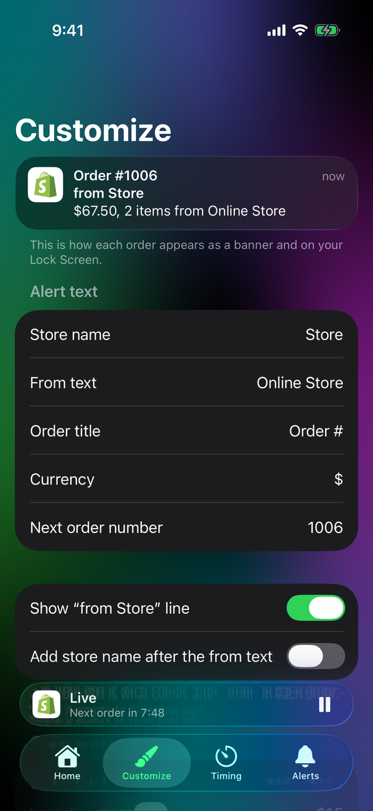 | 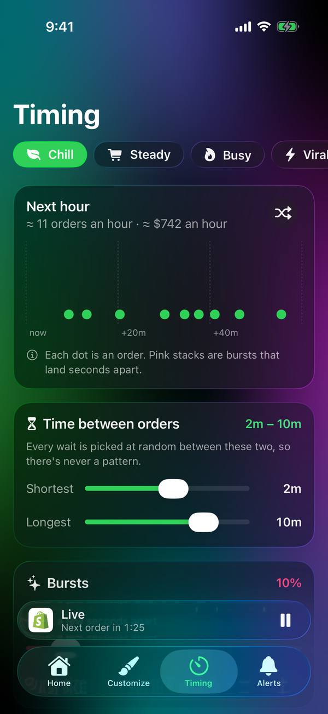 | 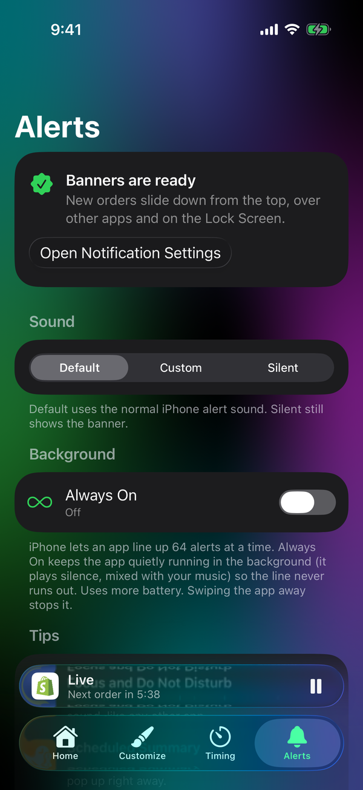 |

| Banner over the Home Screen | Notification Center | Light mode |
| --- | --- | --- |
| 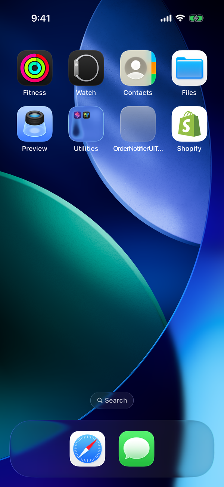 | 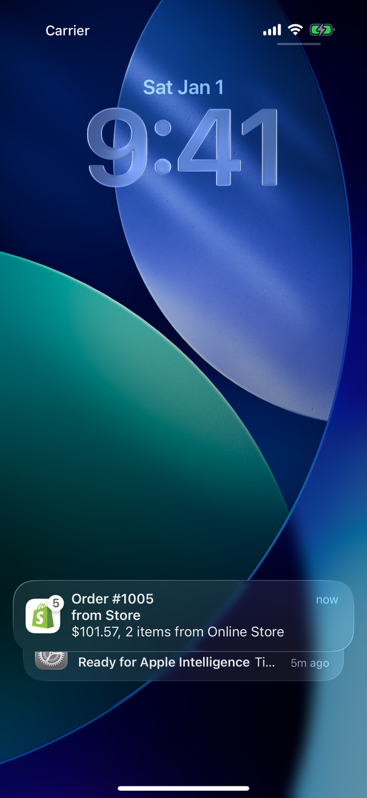 | 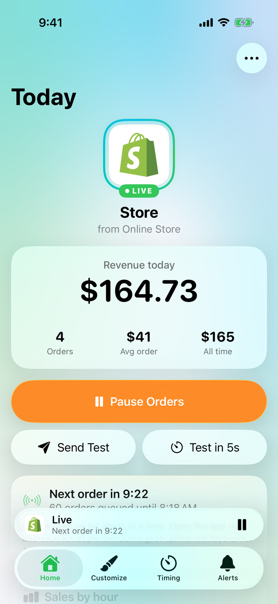 |

### Install with Sideloadly

1. GitHub → **Actions** → latest **iOS** run → download **OrderNotifier-iOS** and unzip it to get
   `OrderNotifier.ipa`.
2. On your computer open [Sideloadly](https://sideloadly.io), plug in the iPhone, drag the IPA in,
   enter your Apple ID and press Start.
3. On the iPhone: Settings → General → VPN & Device Management → trust your Apple ID, and turn on
   Settings → Privacy & Security → Developer Mode (the phone restarts).
4. Open **Store**, tap Continue and allow notifications.

With a free Apple ID the app stops opening after 7 days: install the same IPA again with Sideloadly
(your settings and stats stay). Sideloadly can also refresh it automatically over Wi-Fi.

### Your own name and picture

iPhone always shows the app's own icon and name on its alerts, so they are part of the build:

- **Picture**: replace `ios/Branding/AppIcon.png` (PNG, JPG or HEIC, any size; cropped to a square).
- **Name**: change `"appName"` in `ios/Branding/branding.json`.
- **More pictures** to switch between in the app (Customize → App icon): add them to
  `ios/Branding/Icons/`. The file name becomes the title.

Commit the change on GitHub (works from a phone browser), wait for the **iOS** run, then install the
new IPA over the old one. Texts, prices, timing and sound are changed inside the app as usual.

### How iPhone is different

- iOS lets an app line up only 64 alerts at a time, and apps can't run freely in the background.
  The app plans orders ahead and tops the line back up whenever it runs (open it, tap an alert, or
  when iOS gives it background time). **Always On** (Alerts tab) keeps it running in the
  background by playing silence, so the line never runs out. It uses more battery and stops if you
  swipe the app away.
- Custom sounds (MP3, M4A, WAV, AIFF, CAF) are converted to an iPhone alert sound and cut to 29
  seconds. Focus and Do Not Disturb silence them like any other app.
- No separate small badge: the app icon *is* the picture on every alert.
